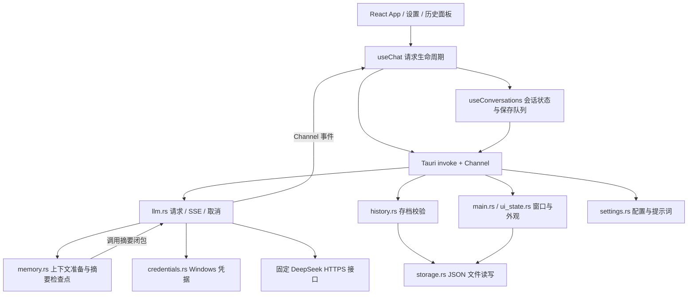

# Deep-Interview 代码仓库梳理

> 本文是首次 Git 上传及联网功能加入前的源码分析快照。后续已建立 Git 提交基线，并实现联网检索；最新使用方式见 README，联网模块与验证见 [联网检索说明](web-search.md)。下文“未跟踪”“尚无联网”等描述保留为初始状态记录。

核验日期：2026-10-30。依据当前工作区源码，版本号 0.1.0。当前 Git 没有可解析的 HEAD，`git ls-files` 为空，现有项目文件均未跟踪；因此本说明对应工作区快照，不能绑定到提交号。未发现仓库内 AGENTS.md。

本次范围是仓库结构、实际调用链、设计取舍和验证，不推断个人贡献、上线规模或性能收益。只新增本文，未修改业务实现。模型名称与参数描述均指代码中的配置，本次未验证供应商当前服务目录。

## 1. 项目定位

这是一个面向 Windows 的个人悬浮 AI 聊天桌面应用。React 提供 WebView 界面，Tauri/Rust 提供窗口、凭据、持久化和模型网络请求，模型通过固定 DeepSeek 接口调用。

已实现：悬浮置顶、紧凑模式、快捷键、托盘、窗口捕获排除、文字流式问答、停止/重试、多会话本地历史、会话内摘要记忆、系统提示词热读取、思考档位、Markdown、主题和窗口位置恢复。

当前源码没有面试题库、简历解析、面试评分流程，也没有语音识别、屏幕理解、附件上传、联网搜索、工具执行、RAG、跨会话记忆或云端同步。产品能力应按当前实现理解，不能仅从项目名称推断。

技术栈：React 19、TypeScript、Vite 6、Tauri 2、Rust、Tokio、reqwest、Windows API；Markdown 用 react-markdown 和 remark-gfm；前端测试使用 Playwright/Edge。没有独立 HTTP 后端、ORM、数据库或 Python Agent 框架。

## 2. 整体架构与边界



这里的 Rust“后端”运行在本机桌面进程体系中，不是服务器。前端通过 IPC 调用命令；生成内容通过 Tauri Channel 回传。`start_chat` 的 Promise 完成仅表示请求被接受，不表示回答完成。

会话完整原文由前端维护，再经 Rust 校验后写入 JSON；上下文压缩策略由 Rust 决定。摘要生成与正常回答复用同一模型请求/流解析代码。

## 3. 文件导航

| 路径 | 职责 | 阅读重点 |
| --- | --- | --- |
| `package.json`、`vite.config.ts`、`tsconfig.json` | 前端依赖、构建、严格类型检查 | Vite 固定 1420 端口；TypeScript include 不含 tests |
| `src-tauri/Cargo.toml`、`Cargo.lock` | 原生依赖及锁定版本 | Tokio、reqwest/rustls、Windows 凭据/GDI |
| `src-tauri/tauri.conf.json` | 窗口、打包和 CSP | 默认隐藏、置顶、透明、内容保护；bundle 关闭 |
| `src-tauri/capabilities/main.json` | 主窗口权限声明 | core 权限与拖动权限；无文件/网络插件权限 |
| `index.html` → `src/main.tsx` | 前端入口 | StrictMode；合成捕获背景的特殊入口 |
| `src/App.tsx` | 页面组装、输入、窗口操作 | chat/history/settings 三个面板，非路由框架 |
| `src/useChat.ts` | 请求状态、事件、取消与重试 | active ref、requestId、accepted/cancel |
| `src/chatData.ts` | 数据类型、恢复、上下文筛选 | 只选完整成功问答，不按轮数截断 |
| `src/useConversations.ts` | 多会话和串行保存 | current ref、Promise 队列、800 ms 保存 |
| `src/HistoryPanel.tsx` | 历史列表、删除确认 | 按 updatedAt 排序，生成时禁止操作 |
| `src/MessageContent.tsx` | Markdown、代码块复制 | HTML 跳过、图片/链接转为文本 |
| `src/useFollowOutput.ts` | 流式滚动阅读 | 自动跟随、用户上翻暂停、恢复跟随 |
| `src/ModelSettings.tsx` | API Key 设置 | 前端不回显已保存 Key；保存不等于鉴权成功 |
| `src/AssistantSettings.tsx` | 思考档位和提示词预览 | 配置状态由 App 获取并共享 |
| `src/useAppearance.ts`、`src/styles.css` | 外观逻辑和全局样式 | 系统主题监听；250 ms 防抖保存 |
| `src/native.ts` | 原生 IPC 包装 | 浏览器环境显式拒绝原生命令 |
| `src-tauri/src/main.rs` | 应用组装、窗口、托盘、快捷键 | 状态注册、命令注册、退出事件 |
| `src-tauri/src/llm.rs` | API 接入与生成任务 | 单请求互斥、取消、SSE、超时 |
| `src-tauri/src/memory.rs` | 记忆算法 | 预算、完整轮次、分片、摘要校验 |
| `src-tauri/src/history.rs` | 存档校验与恢复 | 版本、ID 唯一性、大小限制、streaming 恢复 |
| `src-tauri/src/storage.rs` | 通用文件读写 | 限长读取、临时文件、sync_all、替换 |
| `src-tauri/src/settings.rs` | 提示词定位与思考配置 | 每次请求重新读提示词，偏好写盘后生效 |
| `src-tauri/src/credentials.rs` | Windows 凭据管理 | CredReadW / CredWriteW / CredDeleteW |
| `src-tauri/src/ui_state.rs` | 外观、窗口几何持久化 | DPI、可用工作区、400 ms 防抖 |
| `src-tauri/src/capture_test.rs` | debug 原生捕获探针 | 仅合成测试区域，非产品屏幕采集功能 |
| `scripts/verify-capture.ps1` | 构建并运行捕获验证 | 先要求现有应用退出，45 秒测试超时 |
| `tests/*.spec.ts` | 前端行为和上下文测试 | 浏览器 IPC mock，不调用真实模型 |
| `docs/*.md` | 分阶段实现和验收记录 | 旧阶段数据与当前验证要区分 |
| `启动助手.cmd` | 启动本机已构建 debug exe | 不构建、不安装依赖、不启动开发服务器 |

`node_modules/`、`dist/`、`src-tauri/target/`、`src-tauri/gen/` 是依赖/构建产物；`artifacts/local/` 和 `test-results/` 是本机测试结果，均被 .gitignore 排除。

## 4. 启动链路

1. 开发运行 `npm run desktop`，Tauri 使用 beforeDevCommand 启动 Vite；构建运行 `npm run desktop:build:debug` 或 `desktop:build`，先构建网页再编译原生程序。
2. `main.rs::main` 注册 `ChatState`、单实例插件和全局快捷键插件。
3. setup 获取应用配置目录，创建 `AssistantConfig`、`HistoryStore`、`UiStore`。提示词定位依据 exe 的祖先目录，不依赖启动工作目录。
4. 为主窗口设置内容保护，恢复位置和尺寸，注册 Ctrl+Shift+Space，创建托盘，显示窗口。
5. `src/main.tsx` 渲染 App；各 hook 分别读取历史、外观；App 读取窗口、模型配置状态和助手设置。
6. 历史文件不存在则创建内存中的空会话；历史损坏则显示错误且不创建可写空存档，避免覆盖旧数据。

关闭按钮和系统关闭事件都是隐藏窗口。托盘“退出”调用 `app.exit(0)`。隐藏窗口期间，生成任务继续运行。

## 5. 一次提问的完整调用链

```text
App.send
  → useChat.send → useChat.start
  → chatData.buildContext
  → native.command("start_chat") / Tauri invoke
  → llm::start_chat
      → memory::validate
      → credentials::read
      → AssistantConfig::snapshot
      → 占用 ChatState，启动异步任务
  → llm::run_chat
      → memory::prepare → 必要时 summarize → stream
      → stream → request_body → reqwest POST
      → consume → SseDecoder::push
  → Channel<StreamEvent>
  → useChat.channel.onmessage
  → setMessages / setMemory → UI 渲染 + 本机保存
```

### 前端如何准备消息

App 先检查 Key 状态、助手配置是否读取完成以及思考设置是否正在保存。useChat 使用 ref 同步阻止重复请求，然后插入用户消息和空 assistant 消息，后者状态为 streaming。

`buildContext` 遍历历史，仅保留相邻的 user + assistant 完整对，要求 assistant 状态为 complete 且正文非空。失败/停止的部分回答及其对应提问不参与后续上下文。当前问题作为最后一条 user 消息加入。

### 后端如何处理生成

`start_chat` 校验消息格式、请求 ID、Key 与提示词，并以 Mutex 保证全应用同一时刻只有一个生成任务。锁只用于状态访问，不跨网络 await 持有。通过异步任务执行上下文准备及回答，主命令先返回接受结果。

固定请求模型为 `deepseek-flash`，endpoint 为 `https://api.deepseek.com/chat/completions`；没有运行时更换供应商的抽象。请求使用 Bearer Key、禁止重定向、启用 SSE。系统提示词由 Rust 插入，前端只传 user/assistant 消息。

### 事件协议

| kind | 前端含义 |
| --- | --- |
| compacting | 显示整理会话记忆 |
| memory | text 是序列化的摘要对象或 null，按会话 ID 更新保存 |
| answering | 结束整理状态，进入回答阶段 |
| thinking | 只标记思考进度，不携带/持久化原始推理文本 |
| delta | 将正文增量拼接到本次 assistant 消息 |
| done | 标记 complete；length 结束时附上输出上限提示 |
| error | 保留部分正文并标记失败 |
| cancelled | 保留部分正文并标记已停止 |

每个事件包含 requestId。前端只接受当前 active 请求的事件；后端在发送终态事件前释放请求所有权，允许前端收到完成后立即发起下一次请求。

### 为什么 SSE 不能直接逐网络块转字符串

一个中文字符或 JSON 事件可能横跨网络块。SseDecoder 先缓存字节，遇换行再 UTF-8 解码，兼容 CRLF；按 SSE 空行组合 data，多条 data 用换行连接。它限制 pending 和单事件 data 大小为约 2 MB。

consume 要求正常 finish_reason（stop 或 length）、`[DONE]` 和非空正文。网络 EOF 不视作成功；收到 reasoning_content 只发一次 thinking 事件。这样不会把“只返回思考”“半截断流”标成正常回答。

## 6. 停止、重试和会话隔离

停止链路：`useChat.stop → cancel_chat → CancellationToken.cancel → tokio::select! 取消分支 → cancelled 事件`。select 覆盖 run_chat 整体，所以整理摘要和最终回答都可停止。取消本机等待不构成供应商必然停止计算/计费的证明。

请求可能尚未得到 IPC 接受确认就被用户停止。为处理这个竞态，前端先设置 cancel 标记，待 accepted 置 true 后补发 cancel_chat。后端只取消 requestId 匹配的任务，避免迟到取消误伤新请求。

重试找到最后一条 user 消息，以它之前的历史重新发起，并复用这条用户消息；旧失败 assistant 由新的占位消息替代，因此不重复插入用户提问，也不把失败回答提交给模型。

生成期间，新建、切换、删除会话均被 UI 和 useChat 包装函数阻止。该实现是“全应用单请求”的简化方案；若未来支持后台多会话并行，需要同时改 Rust ChatState、前端 active 状态以及按会话寻址的消息更新。

## 7. 会话记忆算法：最值得深入阅读的模块

### 数据与预算

Memory 包含 version、summary、coveredMessages、digest、updatedAt。coveredMessages 统计的是提交给上下文管理器的有效消息前缀，不是直接对 UI 全部消息做切片；它必须为正偶数，以完整问答对为边界。

```text
可用预算 B = max(0, 128000 - 系统提示词字节数 - 输出预留 - 2048)
消息成本 = Σ(正文 UTF-8 字节数 + 16)
触发整理：组装后的上下文成本 > B × 80%
```

这是应用估算单位，混合了字节成本和输出 token 预留，不是精确 tokenizer，也不是模型官方最大窗口声明。

| 限制 | 源码值 |
| --- | --- |
| 当前问题 | 48000 UTF-8 字节（UI 另有更小限制） |
| 系统提示词文件 | 64 KiB |
| 摘要 | 8000 UTF-8 字节 |
| 历史分片 | 24000 字节，按 UTF-8 边界切分 |
| 摘要生成 | 关闭思考，输出上限 2800 tokens |
| 正常回答输出预算 | off/low/high/max = 4096/8192/16384/32768 |

### 处理过程

1. 验证消息为 user/assistant 交替且最后一条为当前 user，检查体积。
2. 对旧 Memory 做形状校验，再计算其覆盖原文的 SHA-256；不匹配则清除旧摘要，保留原文并重新准备。哈希含角色/正文的长度前缀，避免简单拼接歧义。
3. 立即发出当前有效检查点（可能为 null）。若组装上下文未超过 80% 阈值，直接回答。
4. 反向选择近期完整问答；循环将“当前问题 + 摘要预留 + 近期问答”尽量控制在约半个可用预算内。最近几轮取决于实际长度，没有固定十轮策略。
5. 早期历史按完整问答分组，遇超大组再分片。每片以 JSON 包含 previous_summary 和 new_history，逐步更新摘要。
6. 一整个组所有分片都成功后，才推进 coveredMessages、digest 并发出 memory 检查点。分片中失败不会提交半个组。
7. 组装摘要与近期原文，再核验预算；不能满足则报错，不静默丢弃历史。

最终消息顺序：`system 文件 → user 层的历史摘要 → assistant 确认语 → 未覆盖的近期完整问答 → 当前问题`。摘要有“历史资料、可能不完整”的明确包装，没有被提升成 system 指令；这是一种权限边界设计，不应宣称能完全消除模型提示注入。

完整原文留在本机，不因压缩删除。已有成功批次可在后续失败后复用，但摘要事件发出与真正写盘存在异步间隔。摘要为有损文本，SHA-256 只证明源历史一致，不能证明摘要语义正确，也不是防篡改签名。

## 8. 保存与恢复

数据结构：Archive(version, activeSessionId, sessions) → Conversation(id, title, timestamps, messages, memory) → ChatMessage(id, role, text, status, note?, thinking?)。

`useConversations` 同时保留 React state 和 current ref：前者触发渲染，后者让连续流事件读取最新快照。标题来自首条提问，合并空白后截取 32 个 JS 字符单元。新建会话会复用已有空会话；删除最后一个会话会补建空会话。

保存顺序：`commit → persist → Promise 队列 → save_conversations → HistoryStore.save → storage.write_json`。

- 新问题、消息终态、会话操作和摘要更新立即排队。
- 普通流式增量最多约每 800 ms 发起一次保存；这是定时批量保存，非每个增量都写盘。
- Promise 队列维持提交顺序，Rust Mutex 保护文件访问；只有落盘快照仍是当前快照，UI 才更新“已保存”。
- 写入前校验版本、会话/消息 ID 唯一性、活动会话有效性、role/status、摘要形状以及容量。
- 文件先写 `.tmp`，sync_all 后 rename 替换，减少直接截断原文件造成损坏的风险；没有多版本备份、日志恢复或数据库事务。
- 加载时 streaming 转 cancelled，保留已落盘文字。前后端都具备这一恢复转换。

| 数据 | 保存位置及方式 |
| --- | --- |
| API Key | Windows 凭据管理器，target 为 com.deepinterview.assistant/deepseek |
| 聊天与摘要 | 应用配置目录 conversations.json，普通 JSON，非加密 |
| 外观与窗口几何 | 同目录 ui-settings.json |
| 思考偏好 | 同目录 assistant-settings.json |
| 系统提示词 | 从 exe 向上找到项目结构时使用仓库根目录，否则使用应用配置目录 |

在本项目 Windows 配置下，应用配置目录对应 `%APPDATA%/com.deepinterview.assistant`。存档上限为 25 MiB、500 会话、每会话 10000 条消息，超限提示整理，不自动淘汰旧会话。

## 9. 窗口、配置与显示

- 默认窗口 420×670，最小 360×540；紧凑模式 360×64。收起时保存展开物理尺寸，禁用缩放，展开恢复。
- 主题为 light/dark/system，默认 light；不透明度 75～100，默认 97。useAppearance 监听系统颜色偏好。
- 窗口位置使用物理坐标、尺寸存逻辑单位；恢复时按当前显示器工作区和 DPI 收敛。移动/缩放事件以 revision 和 400 ms 延时合并写入，紧凑尺寸不覆盖展开尺寸。
- 启动和 reveal 均调用 set_content_protected(true)，window_status 回读 affinity 是否为 0x11。UI 显示系统状态，没有关闭保护入口。
- 提示词每次新请求通过 snapshot 重新读取；已开始的请求保留启动时快照。空文件不插入 system；非 UTF-8、不可读取或超限则阻止请求。
- Key 保存做本地格式校验，Windows 凭据 API 执行持久化；前端只获取 hasKey/model/endpoint，不获取已存 Key 值。
- Markdown 用 skipHtml，图片替换为文字，链接渲染成 span；代码块支持复制，没有代码执行和语法高亮。

debug 捕获探针只在 Windows debug 构建、指定命令行参数时启动；它将窗口替换为合成色块，再采样 64×64 区域。主聊天功能不因此具有屏幕理解能力。GDI 色块对照与会议接收端画面是不同验证层。

## 10. 异常与超时

| 情况 | 当前处理 |
| --- | --- |
| 未配置 Key | UI 跳转设置；Rust 也检查凭据是否存在 |
| 重复发送 | 前端 active ref 和后端 ChatState 双重阻止 |
| HTTP 401/402/403/429/5xx | 转换为对应用户错误，不自动重试 |
| 建立连接 / 等待响应头 | 15 秒连接超时；send 阶段 60 秒上限 |
| SSE 长时间无数据 | 每次等下一网络块最多 120 秒 |
| 整体回答超时 | off 180 秒，其余思考档位 600 秒 |
| 摘要超时 | 单次 120 秒；整个上下文准备 600 秒 |
| 生成中错误或停止 | 保留正文，标记终态，提供手动重试 |
| 历史无法读取 | 保留原文件，UI 提示重新加载 |
| 历史保存失败 | 显示重试保存；保留上一次成功文件 |
| 快捷键注册失败 | 记录错误，继续使用托盘 |

超时是分阶段嵌套的，不应把一个超时值解释为整个“整理 + 回答”的总时间限制。

## 11. 本次实际验证

| 执行项 | 2026-10-30 结果 | 证明范围 |
| --- | --- | --- |
| `npm run build` | 成功；tsc + Vite 构建完成 | 前端类型与生产资源构建 |
| `npm test` | 21 passed，约 20.3 秒 | 3 个 spec；IPC mock 交互、上下文筛选、UI |
| `cargo test --manifest-path src-tauri/Cargo.toml` | 16 passed、0 failed、3 ignored | Rust 编译与离线逻辑测试 |
| 收费模型测试 | 未执行 | 不能据此判断当前 Key、余额或远端模型可用性 |
| 原生桌面打包、捕获测试、会议远端验收 | 本次未执行 | 保留现有文档记录，不能视为本次复测 |

Rust 的 16 个离线测试分布：llm 6、memory 4、settings 3、history 1、ui_state 2。三个 ignored 是真实流式、真实思考/提示词、真实摘要记忆 API 测试。

前端测试通过注入 `__TAURI_INTERNALS__` 和模拟 Channel 事件运行；其中 localStorage 用来模拟 Rust 文件存储，不是产品的聊天持久化方案。测试覆盖停止发生在接受确认之前、过期事件、失败重试、摘要恢复、会话隔离、复制、IME、滚动与主题。

历史文档 `phase-1-verification.md` 的“4 项前端测试”是早期阶段记录，当前 21 项见本次结果。关于捕获隐藏恢复后的黑块，验收文档仍明确列为待确认；基础对照通过不能证明该操作链已修复。本次未独立核验这些历史报告和用户反馈。

## 12. 已确认差异与后续改进重点

以下为静态源码观察或据此推断的风险，不代表已做故障复现，也不在本次直接修改。

| 优先级 | 观察与源码证据 | 影响和建议验证 |
| --- | --- | --- |
| 高 | `App.tsx:422` 的 textarea 为 maxLength=4000；`chatData.ts:60` 与 Rust 请求验证为 48000 字节 | UI 更早限制输入，说明只提后者会让用户误解。统一产品限制、显示计数，并分别验证中文/emoji/粘贴 |
| 高 | `main.rs:190` 直接退出；ExitRequested 仅 flush UiStore；`useConversations.ts:20` 保存队列和 800 ms 计时在前端 | 正常托盘退出也可能丢失未写盘增量，并非只有强杀才有该风险。补退出握手/保存确认，测试收到增量后立即退出再恢复 |
| 中 | AssistantConfig::new / UiStore::new 失败由 setup 传播；build 使用 expect | 偏好 JSON 损坏可能阻止启动，用户无法进入设置自救。保留坏文件并设计恢复入口；当前聊天历史损坏已有 UI 错误路径，两者不同 |
| 中 | 每个 delta 更新消息数组，App 映射全部消息，Markdown 随更新重新解析；保存是整个 Archive | 大会话可能增加渲染和写盘开销。先测输入响应、帧耗时、写盘耗时，再考虑增量合并、组件 memo、虚拟列表或分会话存储；目前无性能实测 |
| 中 | TypeScript 和 Rust 重复定义消息/配置协议，事件 kind 在 Rust 是 String，前端 memory 使用类型断言 | 协议演进容易漂移。考虑 Rust 类型化事件和契约生成/验证；当前未知事件的处理并不充分 |
| 中 | `settings.rs::save_thinking` 自行写临时文件，没有复用 storage::write_json 的 sync_all；后者超限错误固定说 25 MiB | 文件写入保证与错误文案不完全统一，ui-settings 的实际上限是 16 KiB。统一存储抽象和针对性错误 |
| 中 | 模型界面版本文案固定，而实际请求是 deepseek-flash 别名 | 源码不能锁定远端实际版本。区分展示名称、请求 ID 与服务返回信息；本次不对官网版本做结论 |
| 维护 | 当前 Git 无 HEAD、所有源码未跟踪；未发现 CI 配置或 LICENSE | 缺少可追溯源码基线和自动门禁。后续先审阅待提交内容、确认许可证意图，再建立版本与 CI；本次不代为提交 |

另需注意：read/write JSON 是整文件操作，文件大小限制不会消除临界容量下的 UI 开销；记忆压缩降低的是模型请求上下文，不能降低本机完整原文存档大小。当前 Windows 凭据模块直接依赖 Windows API，不能仅凭 Tauri 就宣称跨平台可用。

## 13. 推荐源码阅读顺序

| 顺序 | 阅读路径与符号 | 目标 | 预计时间 |
| --- | --- | --- | --- |
| 1 | package.json → tauri.conf.json → main.rs::main → src/main.tsx → App | 解释桌面进程与 WebView 如何接起来 | 20～30 分钟 |
| 2 | chatData 类型 → useChat.send/start → llm::start_chat/run_chat → consume | 从输入一直追到增量显示 | 45～60 分钟 |
| 3 | useChat.stop/retry → cancel_chat → tokio::select! → chat.spec.ts | 解释重复请求、迟到事件、取消竞态 | 30～40 分钟 |
| 4 | useConversations.commit/persist → history.rs → storage.rs | 区分内存更新、排队、成功落盘、重启恢复 | 30～45 分钟 |
| 5 | memory::validate/matches/prepare/assembled → memory tests | 手算何时压缩、保留哪些原文、失败恢复到哪里 | 45～60 分钟 |
| 6 | settings.rs → credentials.rs → AssistantSettings/ModelSettings | 解释提示词热更新、思考偏好和凭据边界 | 20～30 分钟 |
| 7 | main.rs::reveal/set_compact → ui_state::record/restore/fit → capture_test | 区分窗口状态、DPI 恢复、捕获实验与远端验收 | 30～45 分钟 |
| 8 | MessageContent → useFollowOutput → useAppearance → styles.css | 理解流式阅读、输出显示和主题体验 | 20～30 分钟 |

前置知识：React state/ref/effect 与闭包、Promise 队列、Tauri IPC/Channel、Rust Result/Mutex、async/await 与 Future 取消、UTF-8/SSE、JSON 序列化、文件持久化、哈希一致性。并发、状态恢复与上下文预算是最适合深入讲解的三个主题。

阅读自检：为什么 start_chat 返回后还要等待 Channel？为什么取消需要 accepted 标志？为什么失败回答不进入 buildContext？摘要检查点为何按完整组提交？SHA-256 能验证什么、不能验证什么？为什么压缩不能让 conversations.json 变小？为什么浏览器测试不能证明窗口保护有效？

若某文件或原理看不懂，请继续追问 AI；本技能负责给学习路径与题目，不提供逐行讲解。本文已给出跨模块主链，后续可选择其中一条按真实函数调用展开。
